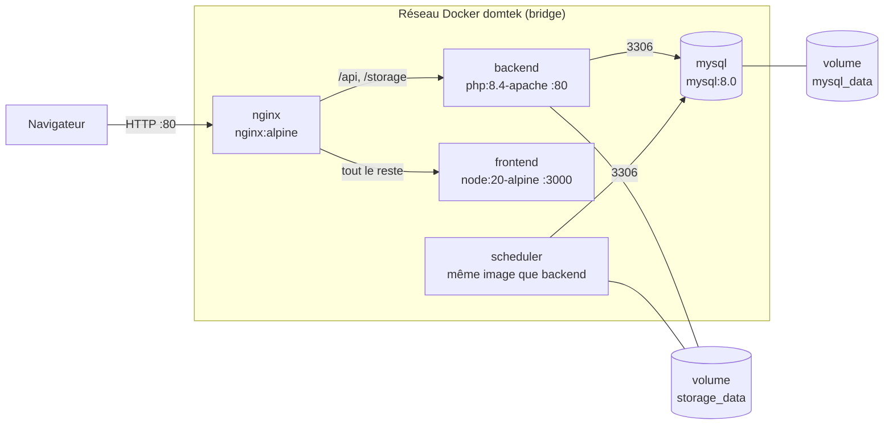
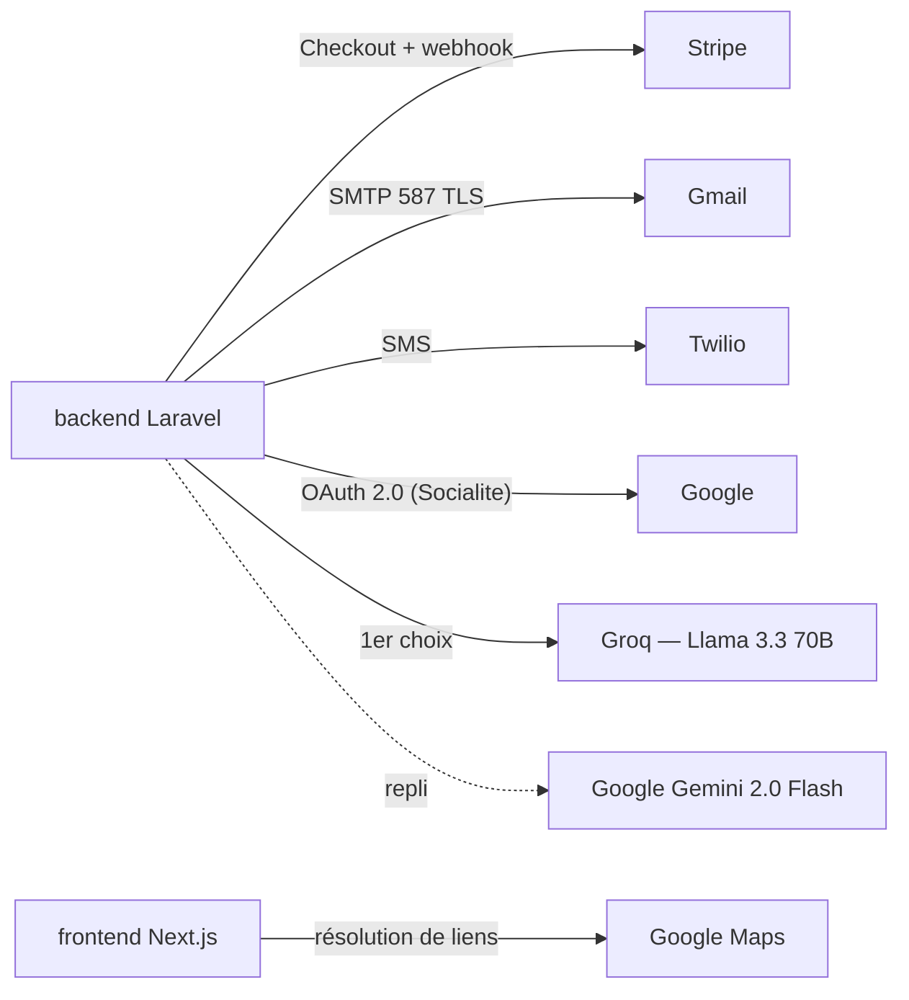
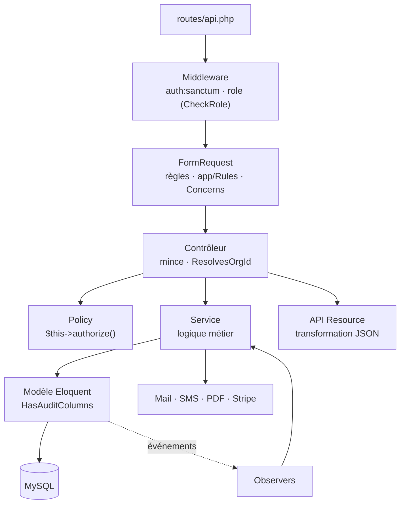
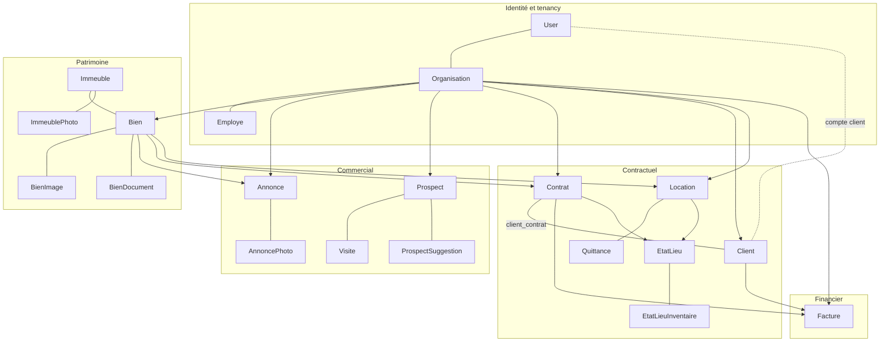
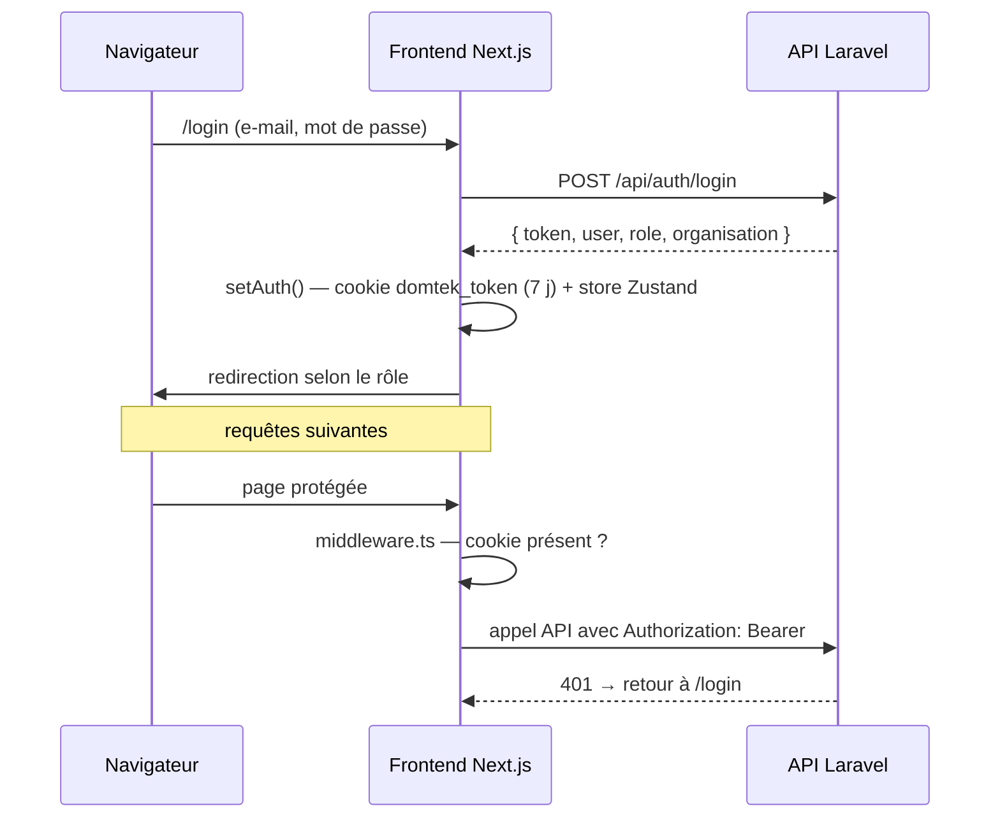
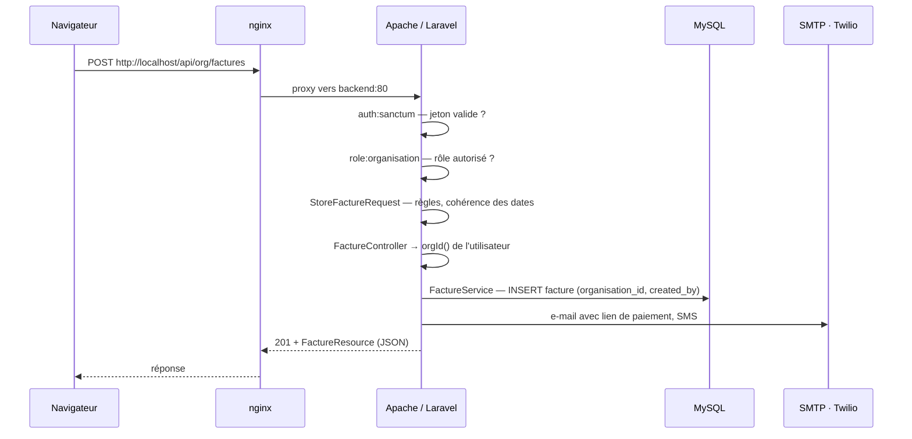

# Architecture — SILA (Domtek)

Ce document décrit l'architecture **physique** (où et comment l'application s'exécute) et l'architecture **logique** (comment le code est organisé et comment une requête le traverse).

Pour le modèle de données détaillé, voir `UML_DOCUMENTATION.md` ; pour les fonctionnalités, `DESCRIPTION_SILA.md`.

---

## 1. Vue d'ensemble

Domtek est une application web **multi-agences** (multi-tenant) de gestion immobilière, en trois tiers :

| Tier | Technologie | Rôle |
|---|---|---|
| Présentation | Next.js 16 (App Router), React 19, TypeScript, Tailwind 4 | Interfaces publique, agence, administration et espace client |
| Application | Laravel 12, PHP 8.4, API REST, Laravel Sanctum | Règles métier, validation, autorisation, envoi d'e-mails et SMS, PDF |
| Données | MySQL 8.0 | Données métier, sessions, cache, file d'attente, jetons |

Le frontend ne parle **qu'à l'API** : il n'accède jamais directement à la base. Chaque agence dispose de son espace sous `/{slug}`, et toutes ses données sont isolées par la colonne `organisation_id`.

---

## 2. Architecture physique

### 2.1 Déploiement Docker Compose

L'application tourne dans **cinq conteneurs** reliés par un réseau privé `domtek` (bridge). Un seul port est exposé sur la machine hôte : le **80**, celui de nginx.



| Conteneur | Image | Port interne | Rôle |
|---|---|---|---|
| `nginx` | `nginx:alpine` | 80, **publié sur l'hôte** | Reverse proxy, point d'entrée unique |
| `frontend` | construite depuis `domtek-frontend/` | 3000 | Serveur Node du build Next.js `standalone` (`node server.js`) |
| `backend` | `domtek-backend:latest` | 80 | Apache + PHP 8.4 servant Laravel (`DocumentRoot /var/www/html/public`) |
| `scheduler` | `domtek-backend:latest` | — | Boucle `php artisan schedule:run` toutes les 60 s |
| `mysql` | `mysql:8.0` | 3306 | Base `domtekdb`, avec un contrôle de santé `mysqladmin ping` |

**Ordre de démarrage** : `mysql` doit être déclaré sain avant `backend` (`condition: service_healthy`) ; `scheduler` attend `backend` ; `nginx` attend `backend` et `frontend`. Tous les services redémarrent automatiquement (`restart: unless-stopped`).

### 2.2 Routage nginx

Fichier `docker/nginx.conf` :

| Préfixe d'URL | Destination | Remarque |
|---|---|---|
| `/api/…` | `backend:80` | Transmet `Host`, `X-Real-IP`, `X-Forwarded-For`, `X-Forwarded-Proto` |
| `/storage/…` | `backend:80` | Fichiers téléversés (photos, documents, PDF) |
| `/` (tout le reste) | `frontend:3000` | Avec prise en charge du protocole `Upgrade` (WebSocket) |

Taille maximale d'une requête : **20 Mo** (`client_max_body_size`), pour les téléversements de photos et de documents.

Comme le navigateur atteint le frontend **et** l'API par la même origine (`http://localhost`), il n'y a pas d'appel cross-origin en production. Le CORS du backend autorise toutefois toutes les origines, ce qui permet au serveur de développement (port 3000) d'appeler l'API.

### 2.3 Construction des images

**Backend** (`Domtek/Dockerfile`), en deux étapes :
1. `composer:2` installe les dépendances PHP (`--no-dev`) ;
2. `php:8.4-apache` reçoit les extensions `pdo_mysql`, `mbstring`, `exif`, `pcntl`, `bcmath`, `gd` (JPEG, FreeType), `zip`, `intl`, et le module `rewrite`. Le code est copié dans l'image, puis l'autoloader Composer est optimisé.

**Frontend** (`domtek-frontend/Dockerfile`), en trois étapes :
1. `deps` : `npm ci`, suivi d'une vérification que `node_modules/.bin/next` existe. Une installation interrompue fait ainsi échouer l'étape au lieu d'être mise en cache ;
2. `builder` : `next build`, avec `NEXT_PUBLIC_API_URL` passée en argument de build ;
3. `runner` : seule la sortie `standalone` et les fichiers statiques sont copiés, exécutés par un utilisateur non root (`nextjs`).

> **Conséquence importante** : le code est **intégré aux images**. Toute modification exige une reconstruction (`docker compose up -d --build`) ; un simple redémarrage ne la prend pas en compte. De même, `NEXT_PUBLIC_API_URL` est figée au moment du build du frontend.

### 2.4 Démarrage du backend

Au lancement du conteneur, `Domtek/docker/entrypoint.sh` :
1. crée les répertoires `storage/framework/{cache,sessions,views}` ;
2. crée le lien `public/storage` → `storage/app/public` ;
3. applique les migrations (`php artisan migrate --force`) ;
4. met en cache la configuration et les routes (`config:cache`, `route:cache`) ;
5. lance Apache au premier plan.

Les migrations sont donc appliquées **automatiquement** à chaque déploiement.

### 2.5 Persistance

| Donnée | Emplacement | Survit à la recréation des conteneurs |
|---|---|---|
| Base de données | volume `mysql_data` | Oui |
| Fichiers téléversés | volume `storage_data`, monté dans `backend` et `scheduler` | Oui |
| Logs Laravel | `storage/logs` dans le conteneur `backend` | **Non** |
| Code applicatif | images Docker | Reconstruit à chaque build |

Le volume `storage_data` est partagé entre `backend` et `scheduler` pour que les deux voient les mêmes fichiers.

### 2.6 Configuration et secrets

- Toutes les variables du backend viennent de `Domtek/.env`, injecté par `env_file`. Docker les lit à la **création** du conteneur : après une modification, il faut le recréer (`up -d --force-recreate backend`).
- `Domtek/.env` et `domtek-frontend/.env.local` ne sont **pas versionnés**. Le modèle documenté est `Domtek/.env.example`.
- Le `.env` racine fournit aux conteneurs `NEXT_PUBLIC_API_URL` et les mots de passe MySQL.

### 2.7 Services externes



| Service | Usage | Point d'intégration |
|---|---|---|
| **Stripe** | Paiement des factures en ligne | `GET /api/pay/{token}` crée une session Checkout et redirige ; `POST /api/stripe/webhook` marque la facture payée |
| **Gmail SMTP** | Activation des comptes clients, factures, réinitialisation de mot de passe, vérification d'e-mail | `Mail::send` (envoi synchrone), vues `resources/views/emails/` |
| **Twilio** | SMS au client à la création d'une facture | `App\Services\SmsService` |
| **Google OAuth** | Inscription et connexion par compte Google | `SocialAuthController` (Laravel Socialite) |
| **Groq**, puis **Gemini** | Génération automatique de la description d'un bien | `GenerateDescriptionController` : Groq d'abord, Gemini en repli si Groq échoue ou n'est pas configuré |
| **Google Maps** | Aperçu de la localisation d'un bien | Composant `MapPreview` ; la route Next.js `/api/resolve-url` suit les redirections des liens courts |

### 2.8 Mode développement

Le frontend peut aussi tourner **hors Docker**, avec rechargement à chaud :

```
cd domtek-frontend && npm run dev     # http://localhost:3000
```

Il appelle alors l'API via nginx (`NEXT_PUBLIC_API_URL=http://localhost/api` dans `.env.local`). Le backend, MySQL et le scheduler restent dans Docker. Les commandes Artisan s'exécutent dans le conteneur (`docker compose exec -T backend php artisan …`), car le nom d'hôte `mysql` n'existe que sur le réseau Docker.

---

## 3. Architecture logique — backend (`Domtek/`)

### 3.1 Couches



| Couche | Emplacement | Responsabilité |
|---|---|---|
| **Routes** | `routes/api.php` | Déclaration des points d'entrée, regroupés par rôle |
| **Middleware** | `app/Http/Middleware/CheckRole.php` (alias `role`) + `auth:sanctum` | Authentification par jeton et contrôle du rôle ; rejette aussi un compte désactivé |
| **FormRequest** | `app/Http/Requests/{Auth,Admin,Org}` | Validation des entrées. Une `Store…Request` et une `Update…Request` par entité, qui doivent porter les mêmes contraintes |
| **Règles partagées** | `app/Rules/` | `TelephoneTunisien`, `NumeroPieceIdentite`, `CodePostalTunisien` |
| **Validation partagée** | `app/Http/Requests/Concerns/` | Traits `VerifieRelevesCompteurs`, `VerifieStructureImmeuble` |
| **Contrôleurs** | `app/Http/Controllers/Api/{Admin,Organisation,Client,Public}` | Minces : valider, autoriser, appeler un service, renvoyer une ressource |
| **Policies** | `app/Policies/` (10) | Vérifient que la ressource appartient à l'organisation de l'utilisateur |
| **Services** | `app/Services/` (17) | Toute la logique métier |
| **Modèles** | `app/Models/` (21) | Eloquent, relations, casts |
| **Observers** | `app/Observers/` | Réactions automatiques aux événements des modèles |
| **Resources** | `app/Http/Resources/` (+ `Espace/`) | Forme du JSON renvoyé ; les ressources `Espace/` sont réduites à ce qu'un client a le droit de voir |
| **Traits** | `app/Traits/` | `HasAuditColumns` (remplit `created_by`/`updated_by`), `ResolvesOrgId` (organisation de l'utilisateur courant) |
| **Traductions** | `lang/fr/validation.php` | Messages de validation et libellés des champs en français |

### 3.2 Groupes de routes

| Groupe | Middleware | Routes déclarées | Contenu |
|---|---|---|---|
| Authentification | aucun | 13 | Inscription, connexion, Google OAuth, mot de passe oublié, activation d'espace client |
| Public | aucun | 6 | Annonces publiées, agences, paiement Stripe, webhook |
| Profil | `auth:sanctum` | 5 | `/auth/me`, déconnexion, modification du profil |
| Administration | `role:admin` | 8 | Organisations : liste, détail, activation, suppression, consultation |
| Espace client | `role:client` | 7 | Résumé, contrats (+ PDF), factures, quittances — lecture seule |
| Agence et employés | `role:organisation,employe` | 72 | Biens, annonces, contrats, locations, clients, prospects, visites, tâches, statistiques… |
| Agence seule | `role:organisation` | 27 | Actions réservées : employés, factures, suppressions, téléversements… |

### 3.3 Services

| Domaine | Services |
|---|---|
| Authentification et comptes | `AuthService`, `ClientAccountService` |
| Organisations | `OrganisationService` |
| Patrimoine | `BienService`, `ImmeubleService` |
| Commercial | `AnnonceService`, `ProspectService`, `ProspectMatchingService`, `VisiteService` |
| Contractuel | `ContratService`, `LocationService`, `EtatLieuService`, `ClientService` |
| Financier | `FactureService` |
| Ressources humaines | `EmployeService` |
| Espace client | `EspaceClientService` |
| Communication | `SmsService` |

### 3.4 Traitements automatiques

| Déclencheur | Mécanisme | Effet |
|---|---|---|
| Création d'une fiche client | `ClientObserver` → `ClientAccountService` | Crée le compte de connexion et envoie le lien d'activation. S'exécute **après** la validation de la transaction ; un échec est journalisé sans bloquer la création |
| Création, modification ou suppression d'un bien ou d'un prospect | `BienObserver`, `ProspectObserver` → `ProspectMatchingService` | Recalcule les suggestions de biens pour les prospects (`prospect_suggestions`, score de 0 à 100) |
| Toutes les minutes | Scheduler → `annonces:publier` | Publie les annonces planifiées dont la date est atteinte |
| À la demande | `php artisan suggestions:refresh [--org=]` | Recalcule toutes les suggestions |
| Création d'une facture | `FactureService` | E-mail avec lien de paiement, et SMS |

Les drivers de file d'attente, de cache et de session sont tous en **base de données** (`QUEUE_CONNECTION`, `CACHE_STORE`, `SESSION_DRIVER = database`). Aucun worker de file n'est déployé : les e-mails partent **de manière synchrone**, d'où leur protection par `try/catch` pour qu'un SMTP indisponible ne fasse pas échouer l'opération.

### 3.5 Isolation des données (multi-tenant)

1. L'organisation de l'utilisateur est déduite de son compte, jamais du formulaire : `User::resolveOrgId()`. C'est l'organisation dont il est propriétaire (rôle `organisation`), ou celle à laquelle il est rattaché (rôle `employe`).
2. Les services filtrent toutes leurs requêtes sur cet `organisation_id`.
3. Les policies refusent l'accès à une ressource d'une autre organisation.
4. L'unicité de l'e-mail d'un client est **propre à chaque agence** (index `organisation_id, email`) : une même personne peut être cliente de plusieurs agences avec un seul compte.

L'espace client applique la même logique : chaque requête est limitée aux fiches clients rattachées au compte connecté (`User::clientProfiles()`). Une ressource d'un autre client renvoie **404**.

### 3.6 Domaines de données



Toutes les tables métier portent les colonnes d'audit `created_by`, `updated_by`, `created_at`, `updated_at`. Le détail des classes et des multiplicités est dans `UML_DOCUMENTATION.md`.

---

## 4. Architecture logique — frontend (`domtek-frontend/src/`)

### 4.1 Organisation des dossiers

| Dossier | Contenu |
|---|---|
| `app/` | Pages (App Router), regroupées par espace |
| `components/` | Composants partagés : aperçus de contrat, de facture et de quittance, carte, notifications, calendrier, formulaire à étapes, gestion globale des erreurs, `ui/` |
| `store/authStore.ts` | État d'authentification (Zustand) |
| `lib/` | `api.ts` (client HTTP), `validation.ts`, `org-path.ts`, `espace.ts`, `query-client.ts` |
| `hooks/` | Hooks React Query par module |
| `constants/routes.ts` | Chemins de l'application |
| `types/index.ts` | Types TypeScript des réponses de l'API |
| `middleware.ts` | Garde des routes, exécutée côté serveur Next.js |

### 4.2 Espaces de l'application

Les **groupes de routes** Next.js (dossiers entre parenthèses) séparent les espaces sans apparaître dans l'URL. Chacun a son propre layout.

| Groupe | URL | Utilisateurs | Contenu |
|---|---|---|---|
| (racine) | `/`, `/annonces`, `/organisations`, `/paiement` | Visiteurs | Accueil, annonces publiées, agences, retour de paiement |
| `(auth)` | `/login`, `/register/…`, `/reset-password`, `/auth/google/callback`… | Tous | Connexion, inscriptions, mot de passe, activation d'espace client |
| `(admin)` | `/admin/…` | `admin` | Gestion des organisations |
| `(dashboard)` | `/[slug]/…` | `organisation`, `employe` | Espace de l'agence : biens, annonces, contrats, locations, quittances, factures, clients, prospects, employés, visites, tâches, états des lieux, statistiques, compte |
| `(client)` | `/espace/…` | `client` | Espace client : accueil, contrats, factures, quittances |

### 4.3 Authentification et état



- **Jeton** : un jeton Sanctum, conservé dans le cookie `domtek_token` (7 jours). Le cookie est la seule source de vérité : le store Zustand **ne persiste pas** le jeton.
- **Store** (`authStore`, persisté dans `localStorage` sous `domtek-auth`) : `user`, `organisation`, `role`. Méthodes `setAuth` (ignore un jeton vide), `clearAuth`, `updateOrganisation`.
- **Cookie `org-slug`** : lu par `middleware.ts` pour renvoyer un utilisateur déjà connecté vers son espace.
- **Client HTTP** (`lib/api.ts`) : une instance Axios dont l'intercepteur ajoute `Authorization: Bearer` depuis le cookie, et renvoie vers `/login` sur une réponse 401.
- **Gardes à deux niveaux** : `middleware.ts` vérifie la présence du cookie avant de servir une page ; chaque layout vérifie ensuite le rôle (un utilisateur d'un autre rôle est redirigé). L'autorisation réelle reste faite par l'API.
- **Liens de l'espace agence** : construits à partir de `organisation.slug` (`orgPath()` transforme `/dashboard/x` en `/{slug}/x`). Si l'organisation manque dans le store, le layout la récupère via `GET /api/auth/me`.

### 4.4 Données et formulaires

- **Récupération des données** : la plupart des pages appellent l'API directement via `api.ts`. Des hooks React Query existent dans `hooks/` (biens, annonces, clients, contrats, factures, employés, organisations, annonces publiques, agences) mais ne sont pas encore utilisés partout.
- **Validation dans le navigateur** (`lib/validation.ts`), sur deux niveaux :
  - à la frappe : `filtreTelephone` et le filtre chiffres du CIN rendent impossible la saisie de lettres ; `borneDate` borne les calendriers ;
  - à l'envoi : fonctions `isValid*` et `validatePassword`.
- Le serveur **revalide toujours** : les contrôles du navigateur améliorent l'ergonomie, ils ne protègent rien.

---

## 5. Parcours d'une requête

Exemple : le responsable d'une agence enregistre une facture. Cette action est réservée au rôle `organisation` ; un employé recevrait une erreur 403.



À chaque étape, un refus arrête la requête : **401** sans jeton valide, **403** pour un rôle non autorisé ou une ressource d'une autre agence, **422** pour une saisie invalide (messages en français).

---

## 6. Sécurité

| Niveau | Mesure |
|---|---|
| Réseau | Seul nginx est exposé (port 80) ; MySQL, l'API et le serveur Node ne sont joignables que sur le réseau Docker |
| Authentification | Jetons Sanctum ; mots de passe hachés (bcrypt) ; jetons d'activation et de réinitialisation à usage unique et à durée limitée (7 jours et 60 minutes) |
| Comptes clients | Mot de passe initial aléatoire de 32 caractères, jamais communiqué : le client choisit le sien |
| Autorisation | Rôle (`CheckRole`), puis appartenance de la ressource (policies), puis filtrage par `organisation_id` dans les services |
| Validation | Toute entrée passe par une FormRequest ; règles de format et de cohérence côté serveur |
| Exposition des données | Ressources API dédiées à l'espace client, sans données internes de l'agence |
| Secrets | Fichiers `.env` hors de Git, modèle `.env.example` |
| Paiement | Aucune donnée de carte ne transite par l'application : le paiement se fait sur la page Stripe |

**Points d'attention pour une mise en production** : le site est servi en HTTP (pas de certificat TLS) ; le CORS accepte toutes les origines ; les logs ne sont pas persistés en dehors du conteneur.

---

## 7. Limites actuelles et évolutions

- **HTTPS** à mettre en place au niveau de nginx avant toute mise en ligne.
- **Worker de file d'attente** : les e-mails et SMS sont envoyés pendant la requête. Un conteneur `php artisan queue:work` permettrait de les traiter en arrière-plan.
- **Logs** : à monter sur un volume, ou à envoyer vers un service de collecte.
- **CORS** : à restreindre au domaine de production.
- **Tests automatisés** : absents (étapes 10 et 16 de `etapes.md`).
- **React Query** : à généraliser aux pages qui appellent encore l'API directement.
