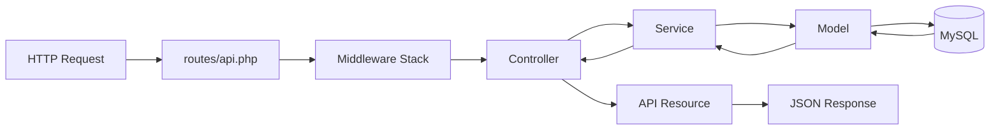
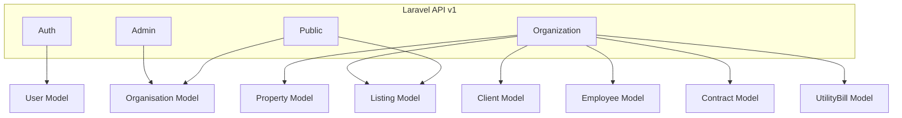

# Backend Architecture — Laravel

## Pattern: MVC + Service Layer



---

## API Design

- **Base URL:** `/api/v1/`
- **Format:** JSON REST
- **Auth:** Laravel Sanctum (token-based)
- **Versioning:** URL-based (`/api/v1/`)

---

## Middleware Stack

| Middleware        | Purpose                                  |
|-------------------|------------------------------------------|
| `auth:sanctum`    | Validate token                           |
| `role:admin`      | Restrict to admin                        |
| `role:organization` | Restrict to organization users        |
| `org.active`      | Block pending/inactive orgs              |
| `org.owner`       | Ensure org user accesses only their data |

---

## Module Breakdown

| Module         | Description                                      |
|----------------|--------------------------------------------------|
| Auth           | Login, register, logout, token refresh           |
| Organizations  | Admin CRUD, activation, status management        |
| Properties     | Sale and rental property management per org      |
| Listings       | Create, schedule, publish listings               |
| Contracts      | Sale and rental contract management              |
| Clients        | Client CRM per organization                      |
| Employees      | Employee CRM per organization                    |
| UtilityBills   | Water, electricity, gas billing per client       |



---

## Service Layer Convention

Each module has a dedicated Service class. Controllers stay thin.

```php
// Bad — logic in controller
public function store(Request $request) {
    $listing = Listing::create([...]);
    $listing->notify(...);
}

// Good — delegate to service
public function store(StoreListingRequest $request) {
    return $this->listingService->create($request->validated());
}
```

---

## Response Format

```json
{
  "success": true,
  "data": { ... },
  "message": "Optional message",
  "meta": { "page": 1, "total": 42 }
}
```

Errors:
```json
{
  "success": false,
  "message": "Validation failed",
  "errors": { "field": ["error message"] }
}
```
