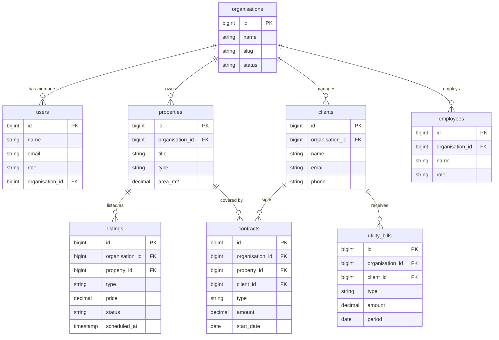

# Database Architecture — MySQL

## Core Rule: Every Table Must Have These 4 Columns

```sql
created_by  BIGINT UNSIGNED NULL
created_at  TIMESTAMP NULL
updated_by  BIGINT UNSIGNED NULL
updated_at  TIMESTAMP NULL
```

No exceptions. This is enforced at the migration level.

---

## Entity Relationship Diagram



---

## Key Design Decisions

- **Soft deletes** on `organisations`, `properties`, `listings`, `clients` — preserve audit trail
- **`organisation_id` on all resource tables** — ensures strict data isolation between agencies
- **`status` on `organisations`** — `pending`, `active`, `inactive` (not boolean)
- **`type` on `properties` and `listings`** — `sale` or `rental` enum
- **`type` on `utility_bills`** — `water`, `electricity`, `gas` enum
- **`scheduled_at` on `listings`** — allows future publication date
