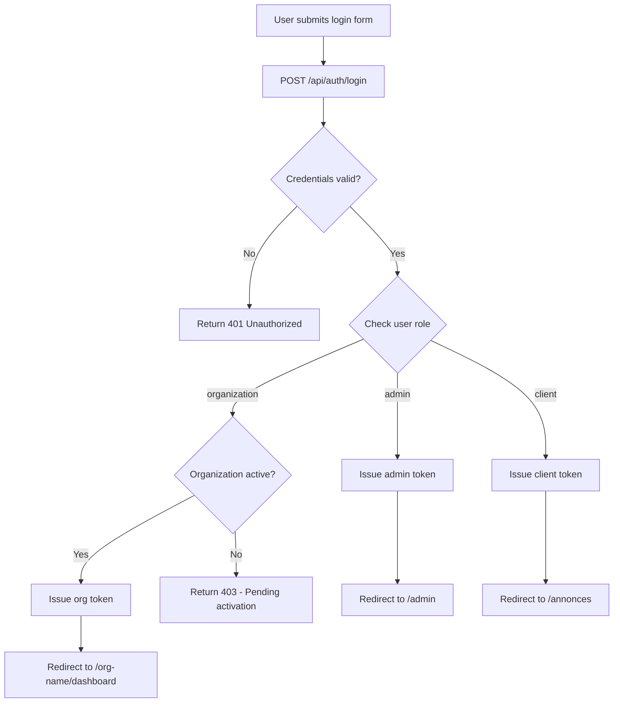
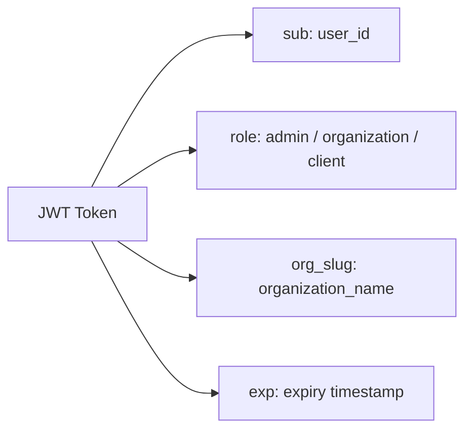
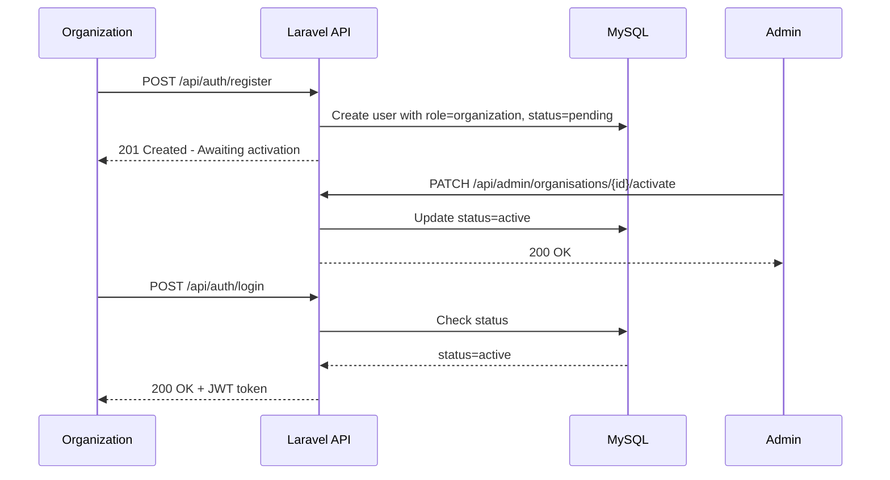

# Authentication Flow

---

## Login and Role-Based Routing

---

## Token Structure (JWT Payload)

---

## Organization Registration and Activation

---

## Route Protection Rules

| Route Pattern               | Allowed Roles          |
|-----------------------------|------------------------|
| `/admin/*`                  | admin only             |
| `/{org_name}/*`             | organization (own org) |
| `/api/admin/*`              | admin only             |
| `/api/org/*`                | organization (active)  |
| `/api/public/*`             | everyone               |
| `/annonces`, `/agences`     | everyone               |
