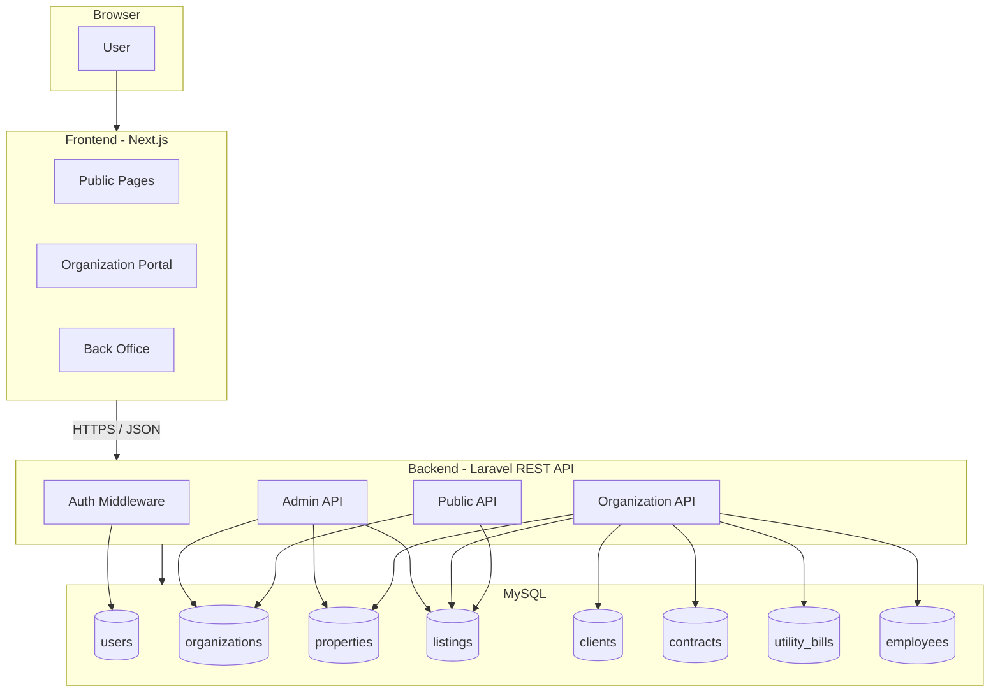
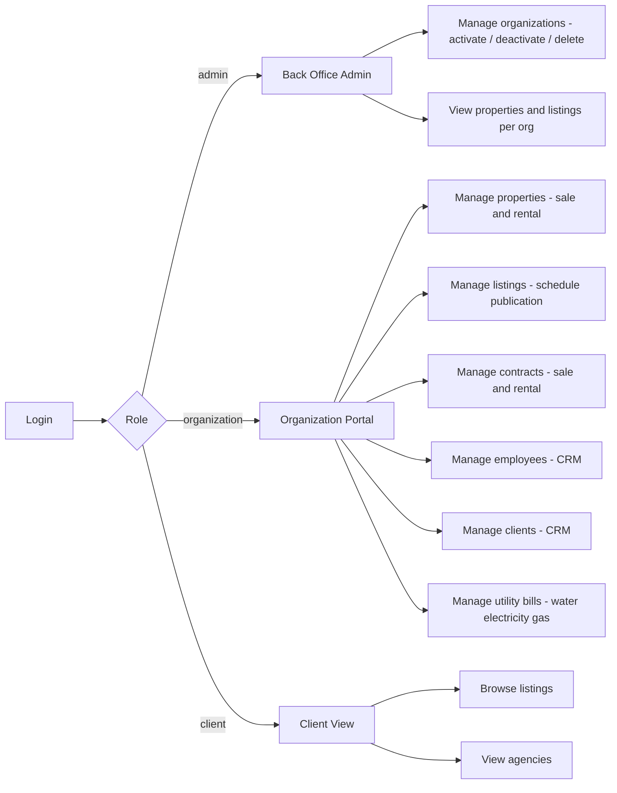
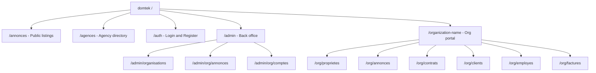
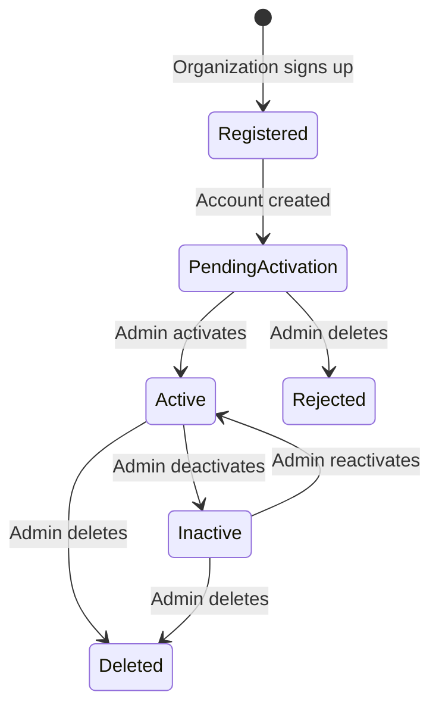

# System Overview — Domtek Real Estate Platform

## Stack

| Layer    | Technology          |
|----------|---------------------|
| Frontend | Next.js (App Router)|
| Backend  | Laravel (PHP)       |
| Database | MySQL               |

---

## Architecture

---

## User Roles

---

## URL Routing

---

## Organization Lifecycle

