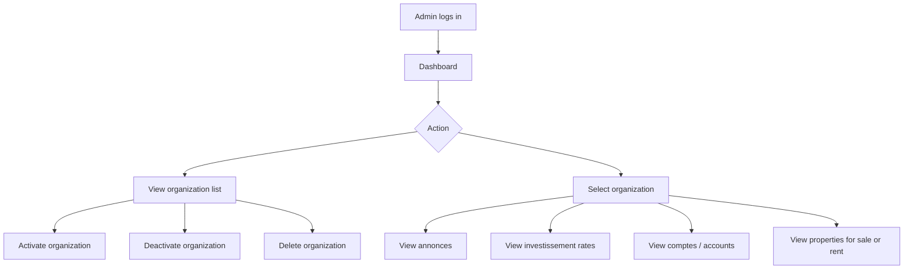
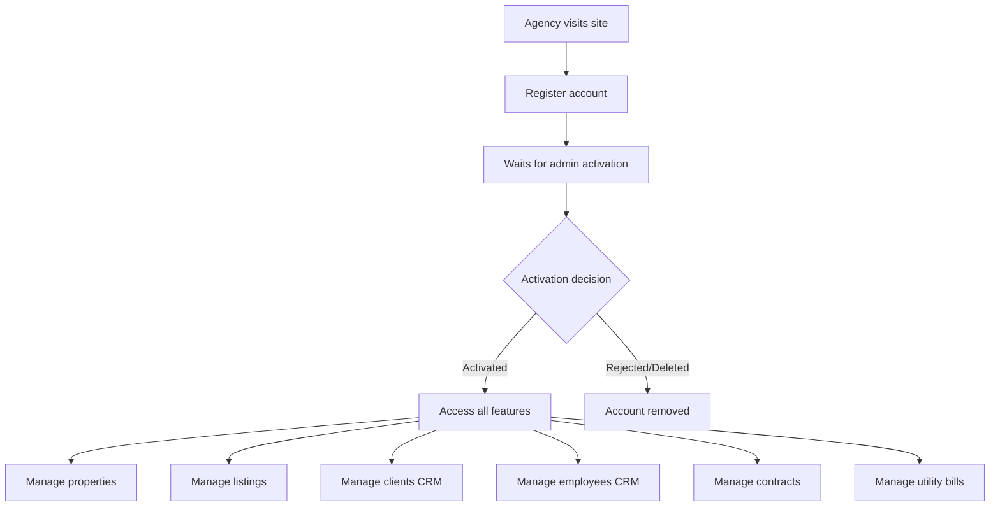
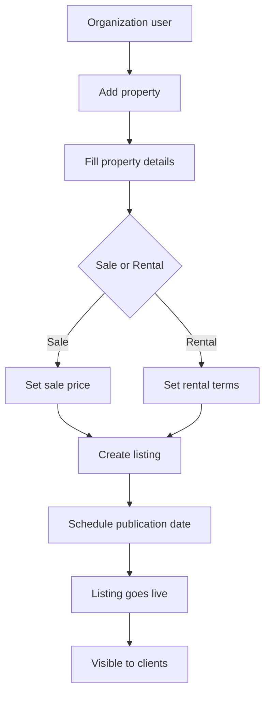
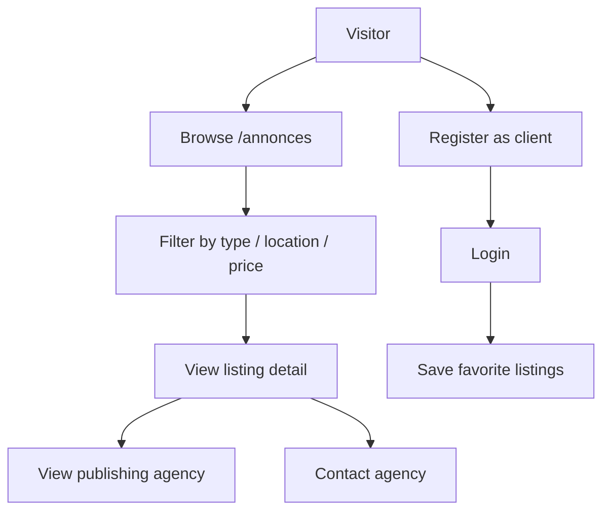
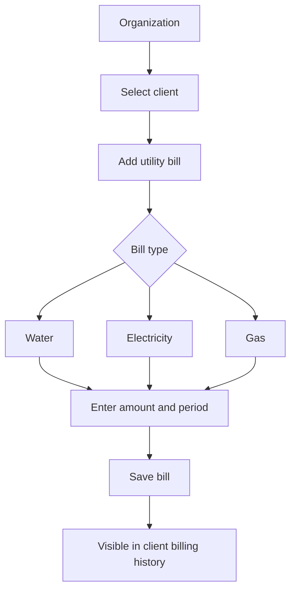

# User Flows

---

## Admin — Back Office Flow

---

## Organization — Onboarding Flow

---

## Organization — Listing Publication Flow

---

## Client — Browsing Flow

---

## Utility Bill Management Flow

