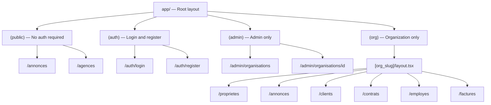
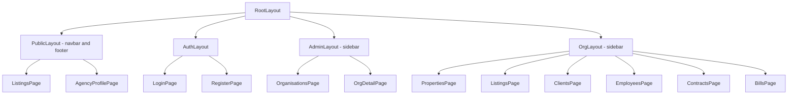
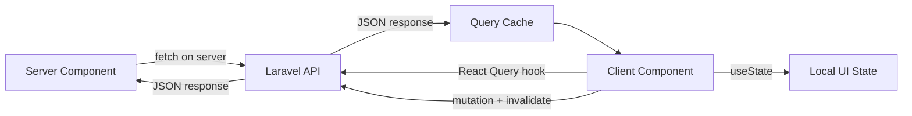

# Frontend Architecture — Next.js

## Router: App Router (Next.js 14+)

Uses the `app/` directory with layouts, nested routes, and server components.

---

## Route Groups



---

## Component Hierarchy



---

## Data Fetching Strategy

| Context                   | Method                                |
|---------------------------|---------------------------------------|
| Public pages (SEO needed) | Server Components + fetch             |
| Dashboard / org pages     | Client Components + React Query       |
| Forms / mutations         | Client Components + API calls         |



---

## State Management

- **Server state:** React Query (`@tanstack/react-query`) for API data
- **UI state:** `useState` / `useReducer` — local component state
- **Auth state:** Next-Auth session or custom context with token

---

## API Communication

All API calls go through a centralized client:

```ts
// lib/api.ts
const api = axios.create({
  baseURL: process.env.NEXT_PUBLIC_API_URL + '/api/v1',
  headers: { 'Content-Type': 'application/json' },
});

// Attach token on every request
api.interceptors.request.use((config) => {
  const token = getToken();
  if (token) config.headers.Authorization = `Bearer ${token}`;
  return config;
});
```
