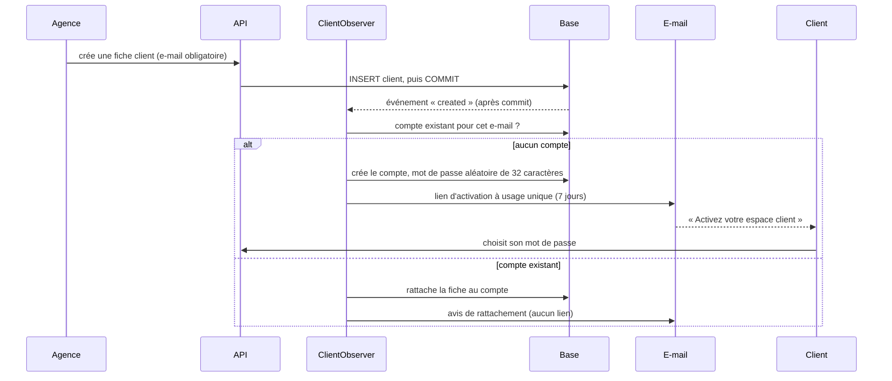
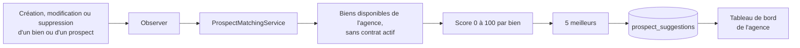
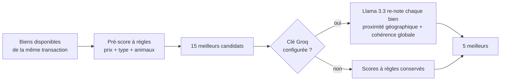
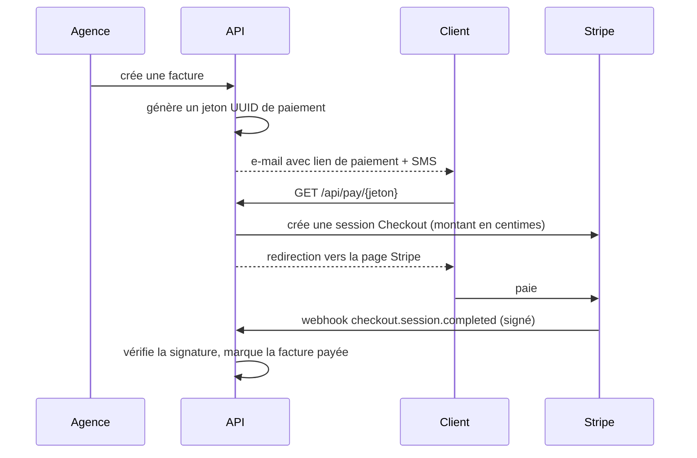

# Méthode — métiers avancés, technologies et méthodes de réalisation

Ce document présente les **fonctionnalités métier avancées** qui font la valeur de Domtek, et explique pour chacune **comment elle est réalisée** : quelle technologie, quelle méthode, côté backend et côté frontend.

Il répond à trois questions pour chaque métier :
1. **Quel problème de gestion immobilière** est résolu ?
2. **Quelle méthode** a été retenue (algorithme, règle, patron de conception) ?
3. **Où** cela se trouve dans le code ?

Pour l'organisation technique d'ensemble, voir `ARCHITECTURE.md`. Pour le modèle de données, `UML_DOCUMENTATION.md`.

---

## Sommaire

1. [Principes méthodologiques transversaux](#1-principes-méthodologiques-transversaux)
2. [Plateforme multi-agences et rôles](#2-plateforme-multi-agences-et-rôles)
3. [Comptes clients automatiques et espace client](#3-comptes-clients-automatiques-et-espace-client)
4. [Score d'opportunité des prospects](#4-score-dopportunité-des-prospects)
5. [Recommandation de biens aux prospects](#5-recommandation-de-biens-aux-prospects)
6. [Gestion des contrats](#6-gestion-des-contrats)
7. [Locations et quittances de loyer](#7-locations-et-quittances-de-loyer)
8. [Facturation et paiement en ligne](#8-facturation-et-paiement-en-ligne)
9. [États des lieux et inventaire](#9-états-des-lieux-et-inventaire)
10. [Documents et aperçus A4](#10-documents-et-aperçus-a4)
11. [Tableaux de bord statistiques](#11-tableaux-de-bord-statistiques)
12. [Notifications et calendrier](#12-notifications-et-calendrier)
13. [Géolocalisation des biens](#13-géolocalisation-des-biens)
14. [Génération de descriptions par IA](#14-génération-de-descriptions-par-ia)
15. [Authentification avancée](#15-authentification-avancée)
16. [Qualité et intégrité des données](#16-qualité-et-intégrité-des-données)
17. [Automatisation et tâches planifiées](#17-automatisation-et-tâches-planifiées)
18. [Déploiement conteneurisé](#18-déploiement-conteneurisé)
19. [Synthèse des technologies](#19-synthèse-des-technologies)
20. [Méthodes de développement et de vérification](#20-méthodes-de-développement-et-de-vérification)

---

## 1. Principes méthodologiques transversaux

Ces principes s'appliquent à tout le projet. Les métiers décrits plus loin en sont des applications.

| Principe | Application concrète |
|---|---|
| **Architecture en couches** | Une requête traverse toujours : route, middleware, validation, contrôleur, autorisation, service, modèle. Chaque couche a une seule responsabilité |
| **Contrôleurs minces, logique dans les services** | Un contrôleur valide, autorise, appelle un service et renvoie une ressource. Toute la logique métier est dans `app/Services/` (17 services) |
| **Validation par classes dédiées** | Aucune validation dans les contrôleurs : une `Store…Request` et une `Update…Request` par entité, qui portent les mêmes contraintes |
| **Défense en profondeur** | Le navigateur filtre et vérifie pour l'ergonomie ; le serveur revalide toujours. Aucun contrôle côté navigateur n'est considéré comme une protection |
| **Isolation multi-tenant** | L'organisation est déduite du compte connecté, jamais du formulaire. Toutes les requêtes sont filtrées par `organisation_id` |
| **Réaction aux événements plutôt qu'appels dispersés** | Les effets automatiques (création d'un compte, recalcul de suggestions) passent par des **observers** Eloquent, pour qu'aucun chemin d'écriture n'y échappe |
| **Transactions pour les opérations composées** | Une opération qui touche plusieurs tables (créer un client et un contrat) est enveloppée dans `DB::transaction` : tout réussit ou rien n'est enregistré |
| **Traçabilité des données** | Trait `HasAuditColumns` : `created_by` et `updated_by` renseignés automatiquement sur chaque table métier |
| **Schéma versionné et réversible** | Toute évolution de la base passe par une migration, avec un `down()` quand c'est possible |
| **Secrets hors du dépôt** | Variables d'environnement, fichier `.env` non versionné, modèle `.env.example` |

---

## 2. Plateforme multi-agences et rôles

**Problème métier.** Plusieurs agences immobilières utilisent la même plateforme sans jamais voir les données les unes des autres, avec des droits différents selon la fonction de chacun.

**Méthode.** Un modèle **multi-tenant à base partagée** : une seule base, une colonne `organisation_id` sur toutes les tables métier, et trois barrières successives.

| Barrière | Mécanisme | Technologie |
|---|---|---|
| 1. Rôle | `CheckRole` (alias `role:`) autorise `admin`, `organisation`, `employe` ou `client` selon le groupe de routes | Middleware Laravel |
| 2. Appartenance | Les policies refusent une ressource d'une autre agence | Policies Laravel (10) |
| 3. Filtrage | Les services ajoutent `where organisation_id = ?` à chaque requête | Eloquent |

L'organisation est obtenue par `User::resolveOrgId()` : l'organisation dont on est propriétaire, ou celle à laquelle l'employé est rattaché. Le trait `ResolvesOrgId` expose cette valeur aux contrôleurs.

**Cycle d'activation.** Une agence qui s'inscrit est `en_attente` : un administrateur doit l'activer. Un employé, créé par son agence, est lui aussi inactif jusqu'à validation. Le statut est contrôlé à la connexion.

**Backend.** `app/Http/Middleware/CheckRole.php`, `app/Policies/`, `app/Traits/ResolvesOrgId.php`, `routes/api.php` (groupes par rôle).
**Frontend.** Chaque espace a son layout qui vérifie le rôle et redirige : `(admin)`, `(dashboard)/[slug]`, `(client)`. Le menu est construit sur `organisation.slug`. Le store `authStore` (Zustand) garde l'utilisateur, l'organisation et le rôle ; le jeton, lui, vit uniquement dans un cookie.

---

## 3. Comptes clients automatiques et espace client

**Problème métier.** Donner à chaque locataire ou acheteur un accès à ses contrats et à ses factures, sans que l'agence ait à créer des comptes à la main, et **sans que l'agence connaisse jamais le mot de passe**.

**Méthode.**



Quatre décisions de conception :

1. **Observer plutôt qu'appel dans les services.** Une fiche client naît à trois endroits : création directe, conversion d'un prospect, saisie depuis un contrat. L'observer sur le modèle `Client` les couvre tous.
2. **Événement après validation de la transaction** (`ShouldHandleEventsAfterCommit`). Un contrat annulé en cours de transaction n'a pas déjà envoyé d'e-mail.
3. **Secret aléatoire jamais divulgué.** Le compte naît avec `Str::password(32)`, haché par le cast `hashed`. Il n'existe que pour interdire toute connexion avant activation. Le client choisit ensuite son mot de passe.
4. **Échec d'envoi non bloquant.** Une erreur SMTP est journalisée, sans annuler la création du client. Le bouton « Renvoyer l'accès » permet de rattraper.

**Multi-agences.** L'unicité de l'e-mail est limitée à chaque agence (index `organisation_id, email`). Une même personne peut être cliente de plusieurs agences : plusieurs fiches pour **un seul compte** (`User::clientProfiles()` en `hasMany`). Son espace agrège alors tous ses contrats.

**Espace client (lecture seule).** Chaque requête est bornée aux fiches du compte connecté. Une ressource qui ne lui appartient pas renvoie **404**, jamais ses données. Des **ressources API dédiées** (`Resources/Espace/`) n'exposent que ce qui le concerne : pas de notes internes, pas de colonnes d'audit.

**Backend.** `ClientObserver`, `ClientAccountService`, `EspaceClientService`, `EspaceController`, broker de mots de passe `clients` dans `config/auth.php`, vues e-mail `activation_compte` et `rattachement_agence`.
**Frontend.** Groupe de routes `(client)` : `/espace`, contrats (avec détail), factures, quittances ; page `reset-password` en mode activation ; fiche client avec statut de l'accès.

---

## 4. Score d'opportunité des prospects

**Problème métier.** Une agence a de nombreux prospects et peu de temps : lesquels sont les plus susceptibles de signer ?

**Méthode.** Un **score de 0 à 100** calculé par règles pondérées (*rule-based scoring*), sans apprentissage automatique, donc explicable et prévisible. Il est recalculé à la demande par `Prospect::scoreOpportunite()`.

| Critère | Valeurs | Points |
|---|---|---|
| Solvabilité | vérifiée 40 · plutôt vérifiée 25 · plutôt non vérifiée 10 · non vérifiée 0 | 0 à 40 |
| Revenus mensuels | moins de 1 000 : 0 · 1 000-2 000 : 5 · 3 000-6 000 : 10 · 7 000-10 000 : 15 · plus de 10 000 : 20 | 0 à 20 |
| A déjà des biens d'intérêt | oui | 10 |
| Visite effectuée | oui | 10 |
| Impression après la visite | très satisfait 20 · satisfait 15 · neutre 10 · plutôt non satisfait 5 · non satisfait 0 | 0 à 20 |

Le total est plafonné à 100. Il s'appuie sur la **dernière visite effectuée**, ou à défaut sur l'impression de la première visite saisie sur la fiche.

**Backend.** `app/Models/Prospect.php` (constantes de pondération, méthode de calcul), relations vers `Visite`.
**Frontend.** Liste des prospects avec une pastille de score colorée par seuil (vert à partir de 75, bleu à 50, orange à 30) ; fiche prospect avec le détail.

---

## 5. Recommandation de biens aux prospects

**Problème métier.** Parmi tous les biens disponibles, lesquels proposer à tel prospect ?

**Méthode.** Deux mécanismes complémentaires : un **moteur de correspondance à règles**, permanent et sans dépendance externe, et un **affinage par IA à la demande**.

### 5.1 Moteur de correspondance à règles (permanent)

Il produit un classement des **5 meilleurs biens** pour chaque prospect, stocké dans `prospect_suggestions`.



**Profil de référence.** Il est déduit des biens que le prospect a déjà marqués comme intéressants (prix moyen, types, villes, transaction). À défaut, un **budget est estimé** à partir de sa tranche de revenus, et sa ville est reprise de sa fiche.

**Pondération du score.**

| Critère | Points | Règle |
|---|---|---|
| Prix | 35 | Écart au prix de référence de 20 % ou moins : 35 · jusqu'à 30 % : 22 · jusqu'à 40 % : 10 |
| Ville | 22 | Identique (sans tenir compte de la casse) |
| Type de bien | 20 | Appartient aux types de référence |
| Type de transaction | 15 | Même transaction (vente ou location) |
| Animaux | 5 | Le bien les accepte et le foyer en a |
| Équipements | 3 | Au moins 3 options, si le prospect valorise les commodités |

Un prospect sans critère connu reçoit un score de base de **30** (disponibilité seule). Les biens déjà marqués comme intéressants sont exclus des suggestions.

**Maintien à jour.** Les observers `BienObserver` et `ProspectObserver` recalculent à chaque changement : un nouveau bien met à jour les suggestions de tous les prospects non convertis de l'agence. La commande `php artisan suggestions:refresh [--org=]` recalcule tout.

**Backend.** `ProspectMatchingService`, `BienObserver`, `ProspectObserver`, `RefreshSuggestions`, `DashboardSuggestionsController`.
**Frontend.** Bloc de suggestions du tableau de bord, avec une pastille de score.

### 5.2 Affinage par IA (à la demande, depuis la fiche d'un prospect)

Quand l'agence consulte un prospect, `ProspectSuggestionsController` applique un **pipeline hybride en deux temps** :



1. **Pré-sélection par règles** : un score rapide et peu coûteux (prix à 15, 25 et 35 % près, type de bien, animaux) réduit tous les biens à **15 candidats**.
2. **Re-notation par IA** : seuls ces 15 biens sont envoyés au modèle, avec le profil du prospect. Il les note selon des critères que les règles ne savent pas évaluer : **proximité géographique** et **cohérence d'ensemble**.
3. **Repli** : sans clé, en cas d'erreur du service ou de panne réseau, les scores à règles sont conservés. La fonctionnalité se dégrade sans jamais échouer : la page affiche toujours des suggestions.

Ce découpage limite le volume envoyé à l'IA (donc le coût et la latence) et garde le résultat exploitable même quand le service est indisponible. Les règles décident de **qui concourt**, l'IA affine **l'ordre**.

**Modèle.** Cette étape exige une réponse en **JSON strict**. Elle utilise un modèle qui répond directement (`GROQ_MODEL_JSON`, Qwen 3.8 27B) : un modèle raisonnant dépense son budget de tokens en réflexion et ne produit rien, ou invalide le format JSON. C'est vérifié sur le prompt réel.

**Backend.** `ProspectSuggestionsController` (appel Groq).
**Frontend.** Panneau de suggestions de la fiche prospect (`prospects/[id]`).

---

## 6. Gestion des contrats

**Problème métier.** Contrats de location et de vente aux règles différentes, plusieurs signataires possibles, et des erreurs coûteuses à éviter : louer deux fois le même bien aux mêmes dates, vendre deux fois le même bien.

### 6.1 Résolution du client en transaction

La création d'un contrat accepte **trois façons** de désigner le client, dans une transaction unique :
- un client **existant** ;
- un **prospect à convertir** (une fiche client est créée à partir du prospect, qui reste visible avec le statut « Converti ») ;
- un **nouveau client** saisi directement dans le formulaire.

La relation contrat-clients est **plusieurs à plusieurs** (table pivot `client_contrat`) : un bail peut avoir plusieurs locataires.

### 6.2 Détection des chevauchements de location

Deux périodes se chevauchent si chacune commence avant que l'autre ne finisse. La condition appliquée est donc :

```
début_existant <= fin_nouveau   ET   (fin_existant est nulle OU fin_existant >= début_nouveau)
```

Un contrat sans date de fin est un bail **ouvert** : il est traité comme se terminant le `9999-12-31`. Les contrats terminés ou résiliés sont ignorés.

Le contrôle existe **à deux niveaux** :
- **Navigateur** : dès le choix du bien, ses contrats actifs sont chargés, et un calcul réactif (`useMemo`) affiche une bannière nommant le contrat en conflit et bloque le bouton. L'utilisateur est prévenu avant d'envoyer.
- **Serveur** : la même requête SQL, dans `ContratService::store`, lève une erreur de validation. C'est elle qui fait foi.

La vente est contrôlée à part : un bien ne peut faire l'objet que d'un seul contrat de vente non résilié.

### 6.3 Propagation du statut du bien

Créer un contrat fait passer le bien à **loué** ou **vendu** ; le terminer ou le résilier le remet **disponible**. Le statut du bien n'est jamais saisi à la main.

### 6.4 Aperçu juridique en temps réel

Le formulaire est en deux colonnes : saisie à gauche, **contrat rédigé en direct à droite**, avec les parties, le bien, la durée, les conditions financières et la signature. Le formulaire s'adapte au mode (location ou vente) : une vente masque la périodicité et la date de fin, et renomme le dépôt de garantie en acompte.

Les calculs sont réactifs : le montant TTC se déduit du HT et de la TVA (`useMemo`), la durée est exprimée en mois ou en années.

**Backend.** `ContratService`, `StoreContratRequest` / `UpdateContratRequest` (cohérence des dates et des montants), `Contrat::TYPES_LOCATION`.
**Frontend.** `contrats/nouveau/page.tsx` (formulaire adaptatif, `useMemo`), composant `ContratPreview` (681 lignes).

---

## 7. Locations et quittances de loyer

**Problème métier.** Suivre, mois par mois, ce que chaque locataire doit, a payé et doit encore, y compris pour les paiements partiels ou tardifs.

**Méthode.**

**Échéancier généré.** `Location::genererPeriodes()` produit la liste des périodes (`AAAA-MM`) depuis la première échéance, avec un pas selon la périodicité (mensuelle, trimestrielle, semestrielle, annuelle). Pour un bail à durée déterminée, jusqu'à la fin du bail ; pour un bail ouvert, jusqu'au mois courant, donc **de nouvelles périodes apparaissent chaque mois**.

**Synchronisation idempotente.** `LocationService::syncQuittances` crée les quittances manquantes avec `firstOrNew`. Relancée autant de fois que nécessaire, elle ne crée aucun doublon et **ne modifie jamais une quittance déjà payée**.

**Statut calculé, jamais saisi.** `Quittance::computeStatut()` déduit le statut du montant payé, de la date de paiement et de l'échéance :

| Situation | Statut |
|---|---|
| Rien payé, échéance à venir | `prevu` |
| Rien payé, échéance dépassée | `impaye` |
| Payé en partie | `partiel` |
| Payé en totalité, à la date ou avant | `paye` |
| Payé en totalité, après l'échéance | `paye_en_retard` |

`enregistrerPaiement` enregistre le montant et recalcule le statut à chaque paiement, ce qui gère naturellement les **paiements partiels** : le reste à payer est la différence entre le dû et le versé.

**Locataire polymorphe.** Le locataire d'une location est désigné par le couple `(locataire_type, locataire_id)` : un client, un prospect, ou une personne saisie sans fiche. Toute requête qui retrouve les locations d'un client filtre sur **les deux colonnes**, sans quoi l'identifiant d'un prospect homonyme exposerait des quittances qui ne sont pas les siennes.

**Backend.** `Location`, `Quittance`, `LocationService`.
**Frontend.** Pages locations et quittances ; composant `QuittancePdf` (quittance de loyer au format A4) ; espace client avec filtre « à régler » qui regroupe `prevu`, `impaye` et `partiel`.

---

## 8. Facturation et paiement en ligne

**Problème métier.** Émettre des factures de loyer et de charges, prévenir le client, et lui permettre de payer sans se déplacer, avec un statut qui se met à jour tout seul.

**Méthode.**



- **Lien de paiement sans compte.** Chaque facture porte un **jeton UUID**. Le lien `/api/pay/{jeton}` identifie la facture sans que le client ait à se connecter. Si la facture est déjà payée, il renvoie vers une page « déjà payé » au lieu d'ouvrir une nouvelle session. L'espace client n'affiche le lien que pour une facture encore due.
- **Stripe Checkout.** La session est créée côté serveur, avec le montant converti en **centimes** (unité de Stripe) et le jeton en métadonnée. Aucune donnée de carte ne transite par l'application.
- **Webhook signé.** `Webhook::constructEvent` vérifie la signature de Stripe avant de faire confiance à l'événement. C'est le webhook, et non le retour du navigateur, qui marque la facture payée : un client ne peut donc pas se déclarer « payé ».
- **Notifications.** Un **e-mail** (Mailable avec le lien) et un **SMS Twilio** partent à la création. Les envois sont protégés par `try/catch` : une panne de SMTP ou de SMS ne bloque pas l'émission.
- **Types de facture** : loyer, eau, électricité, gaz, électricité et gaz, avec une **période concernée**. Pour un loyer, seuls les biens ayant un contrat de location sont proposés.
- **PDF** de la facture générés côté serveur.

**Backend.** `FactureService`, `PaiementController`, `Mail\FactureCreee`, `SmsService`, vues `emails/facture_creee` et `pdf/facture`.
**Frontend.** Formulaire de facture en cascade (le type filtre les biens, le bien filtre les clients), composant `FacturePreview`, bouton « Payer » dans l'espace client.

---

## 9. États des lieux et inventaire

**Problème métier.** Documenter l'état d'un logement à l'entrée et à la sortie, et pouvoir régulariser les charges sur une base indiscutable.

**Méthode.**
- Un état des lieux est de type **entrée** ou **sortie**, rattaché à un contrat **ou** à une location.
- Il consigne les **relevés de compteurs** (eau, électricité, gaz) en décimales à 3 chiffres, la **remise des clés** et un commentaire.
- Il porte un **inventaire** par pièce, classé en quatre catégories : meubles, électroménager, équipements, textile.

**Contrôle de cohérence des compteurs.** Un compteur ne recule pas : le relevé de sortie doit être supérieur ou égal à celui de l'entrée. Le trait `VerifieRelevesCompteurs` cherche l'état des lieux d'**entrée** le plus récent du même contrat ou de la même location, puis compare **chacun des trois compteurs indépendamment**. Le message cite la date de l'entrée et les deux valeurs. Sans état des lieux d'entrée, la sortie est acceptée : les baux antérieurs au module n'en ont pas. Le trait est partagé par la création et la modification, qui doivent l'appliquer toutes deux.

**Backend.** `EtatLieu`, `EtatLieuInventaire`, `EtatLieuService`, trait `VerifieRelevesCompteurs`.
**Frontend.** Pages états des lieux ; l'espace client affiche entrée et sortie avec leurs relevés.

---

## 10. Documents et aperçus A4

L'application produit des documents officiels (contrat, facture, quittance) par **deux mécanismes complémentaires**.

| Mécanisme | Technologie | Usage |
|---|---|---|
| **PDF généré par le serveur** | `barryvdh/laravel-dompdf`, vues Blade `pdf/contrat` et `pdf/facture`, format A4 portrait | Téléchargement fiable et identique pour tous, y compris depuis l'espace client |
| **Aperçu et impression dans le navigateur** | Composants React, CSS `@media print` et `@page` A4, ouverture d'une fenêtre d'impression. L'aperçu du contrat et de la facture est mis à l'échelle de la largeur disponible | Voir le document **pendant** qu'on remplit le formulaire, sans aller-retour serveur |

Aucune bibliothèque de génération de PDF n'est chargée côté navigateur. Les montants sont formatés selon les conventions tunisiennes (`fr-TN`, trois décimales, dinar).

**Backend.** `ContratController::telechargerPdf`, `FactureController::telechargerPdf`, `EspaceController::contratPdf`.
**Frontend.** `ContratPreview`, `FacturePreview`, `QuittancePdf`. Le téléchargement d'un PDF depuis l'espace client passe par Axios en `blob`, puisque la route exige le jeton Bearer : un simple lien renverrait une erreur 401.

---

## 11. Tableaux de bord statistiques

**Problème métier.** Piloter l'activité : taux d'occupation, conversion des prospects, activité des visites, efficacité des canaux d'acquisition.

**Méthode.** Quatre jeux de données, servis par `StatistiqueController`.

| Statistique | Définition | Calcul |
|---|---|---|
| Occupation des biens | Part des biens occupés, mois par mois sur 12 mois | Pour chaque mois : biens créés jusqu'à cette date, dont ceux ayant un contrat actif commencé avant la fin du mois |
| Conversion des prospects | Part des prospects devenus clients | Pour chaque mois : prospects cumulés, dont ceux dont le client a été créé avant la fin du mois |
| Visites | Planifiées comparées aux effectuées | Comptage par mois |
| Canaux | Origine des prospects | `GROUP BY source_connaissance` |

L'**historique est reconstitué rétroactivement** : chaque point répond à « quel était l'état à la fin de ce mois ? », sans table d'historique, en comparant les dates de création et de début aux bornes du mois.

**Frontend.** Les graphiques sont des **SVG écrits à la main**, sans bibliothèque :
- courbe de taux avec zone en dégradé et info-bulle au survol ;
- courbe double (visites planifiées et effectuées) avec grille adaptée à la valeur maximale ;
- anneau pour les canaux.

Les coordonnées sont calculées par des fonctions d'échelle communes (`px`, `py`), de sorte que chaque libellé correspond à une valeur réellement atteinte. La page se **rafraîchit toute seule toutes les 30 secondes** (`setInterval`, nettoyé au démontage) et propose un bouton d'actualisation manuel.

**Backend.** `StatistiqueController` (Carbon, requêtes agrégées).
**Frontend.** `(dashboard)/[slug]/statistiques/page.tsx`.

---

## 12. Notifications et calendrier

**Problème métier.** Ne rien oublier : visites du lendemain, anniversaires de clients et de prospects, échéances de loyer.

**Méthode.** Deux endpoints qui **agrègent plusieurs sources** dans un format unifié.

- `NotificationController` : anniversaires (clients et prospects, avec l'âge calculé) et visites à venir, avec un message prêt à afficher.
- `CalendrierController` : fusionne **visites, quittances et anniversaires** pour un mois donné, chaque élément portant un `type`, une `date`, une heure et un statut.

**Backend.** Requêtes Eloquent par plage de dates, transformation en tableau homogène.
**Frontend.** `NotificationsPopup` (cartes distinctes pour anniversaires et visites) et `FloatingCalendar` : un calendrier flottant accessible depuis toutes les pages de l'espace agence, avec une grille dont la semaine commence le lundi.

---

## 13. Géolocalisation des biens

**Problème métier.** Situer un bien sur une carte à partir de ce que l'agence a sous la main : coordonnées, lien copié depuis une application de cartographie, ou simple adresse.

**Méthode.** Le composant `MapPreview` accepte **trois formes de saisie** et les ramène à des coordonnées :

1. des **coordonnées brutes** (`36.874, 10.273`), validées dans leurs bornes ;
2. une **URL de carte longue**, dont les coordonnées sont extraites par expressions régulières (`@lat,lng`, `q=`, `ll=`, ou dans le chemin) ;
3. un **lien raccourci** (`maps.app.goo.gl`), dont la redirection est suivie **côté serveur** par la route Next.js `/api/resolve-url` (un navigateur ne peut pas la suivre à cause des restrictions entre origines), puis analysé comme une URL longue.

À défaut, le texte est traité comme une **adresse** et géocodé par le service Nominatim d'OpenStreetMap. La carte est ensuite affichée dans une `iframe` OpenStreetMap centrée sur les coordonnées. Aucune clé d'API n'est nécessaire. L'appel est temporisé (*debounce*) pour ne pas solliciter le service à chaque frappe, et les échecs expliquent à l'utilisateur comment obtenir des coordonnées exploitables.

**Frontend.** `components/MapPreview.tsx`, `app/api/resolve-url/route.ts` (route handler Next.js).
**Backend.** Un simple champ `maps_url` sur le bien.

---

## 14. Génération de descriptions par IA

**Problème métier.** Rédiger une annonce attractive prend du temps : produire un premier texte à partir des caractéristiques du bien.

**Méthode.** `GenerateDescriptionController` construit un *prompt* à partir de la fiche du bien (type, transaction, superficie, pièces, chambres, salles de bain, étage, équipements, animaux, adresse, ville), puis interroge **deux services d'IA générative selon un ordre de priorité** :

1. **Groq**, modèle `openai/gpt-oss-120b` (`GROQ_MODEL`), via son API compatible OpenAI. Ce modèle raisonne : son raisonnement est renvoyé dans un champ séparé, et le budget de tokens est dimensionné pour le contenir (1 000) ;
2. **Google Gemini** (modèles `gemini-2.0-flash`, puis `gemini-2.0-flash-lite`) en **repli**, si Groq n'est pas configuré ou échoue.

Chaque fournisseur n'est tenté que si sa clé est présente, et une **panne réseau est attrapée** (`try/catch`) pour permettre le repli sur le fournisseur suivant au lieu de remonter en erreur 500. Les clés restent côté serveur, jamais exposées au navigateur.

**Les modèles sont de la configuration, pas du code.** Les fournisseurs retirent leurs modèles sans préavis : `llama-3.3-70b-versatile` a disparu de Groq et a fait tomber deux fonctionnalités à la fois. Les noms vivent désormais dans `config/services.php` et se changent par `.env`, sans modifier le code.

**Backend.** `GenerateDescriptionController` (appels HTTP avec repli en cascade), clés dans `config/services.php`.
**Frontend.** Bouton « Générer avec IA » du formulaire d'annonce (`annonces/nouvelle`) : une fois le bien choisi, il insère le texte généré dans le champ description, que l'agence relit et modifie.

---

## 15. Authentification avancée

**Problème métier.** Connexion sécurisée, sans mot de passe à retenir si l'utilisateur le souhaite, et récupération de compte.

| Mécanisme | Méthode | Technologie |
|---|---|---|
| **Jetons d'API** | Un jeton personnel par connexion, envoyé en `Authorization: Bearer` | Laravel Sanctum |
| **Connexion Google** | Flux OAuth 2.0 : redirection, retour avec un code, échange contre le profil | Laravel Socialite |
| **Inscription via Google** | Les données du profil Google préremplissent le formulaire. Elles voyagent dans un **jeton chiffré** (`Crypt::encryptString`) qui expire en 30 minutes : le frontend ne reçoit jamais le profil en clair | Chiffrement symétrique Laravel |
| **Liaison de comptes** | Un compte retrouvé par `google_id`, sinon par e-mail, est lié automatiquement | Eloquent |
| **Mot de passe oublié** | Jeton à usage unique, valable 60 minutes | Brokers de mots de passe Laravel |
| **Activation d'un espace client** | Même mécanique, avec un **second broker** valable 7 jours | `config/auth.php` |

**Côté navigateur.** Le jeton est conservé dans un **cookie** (7 jours). Le store Zustand ne persiste pas le jeton : le cookie fait foi, et `setAuth` ignore un jeton vide pour ne jamais écraser la session. Un intercepteur Axios ajoute le jeton à chaque requête et renvoie vers la connexion sur un 401. Après un retour Google, l'application récupère le profil complet par `/auth/me` pour disposer de l'organisation.

---

## 16. Qualité et intégrité des données

C'est le domaine où la méthode est la plus structurée : un **audit complet des formulaires** a recensé vingt manques de contrôle, tous traités.

### 16.1 Règles de format partagées (serveur)

Trois classes de règles réutilisables (`app/Rules/`), déclarées une fois plutôt que recopiées dans chaque formulaire :

| Règle | Contrôle |
|---|---|
| `TelephoneTunisien` | 8 chiffres commençant par 2 à 9, indicatif +216 facultatif, séparateurs tolérés |
| `NumeroPieceIdentite` | Chiffres uniquement ; exactement 8 pour une CIN, longueur libre pour un passeport. Lit le type de pièce dans la requête |
| `CodePostalTunisien` | 4 chiffres |

### 16.2 Cohérences entre champs

Les contraintes qui relient plusieurs champs vivent dans un hook `withValidator()` : échéance après émission, fin de contrat après début, TTC supérieur ou égal au HT, première échéance après le début du bail, relevés de sortie supérieurs à l'entrée, étage et bloc existant dans l'immeuble. Quand le champ de référence n'est pas modifiable, la comparaison porte sur **la valeur enregistrée** et non sur le formulaire.

### 16.3 Logique partagée par traits

Quand plusieurs formulaires appliquent la même logique, elle est mise en trait (`VerifieRelevesCompteurs`, `VerifieStructureImmeuble`) pour que la création et la modification ne divergent pas.

### 16.4 Contrôles dans le navigateur

À la frappe : le téléphone et le CIN refusent les lettres, et les calendriers bornent les dates impossibles (pas de naissance dans le futur). À l'envoi : fonctions de vérification avec messages dans le formulaire. Ces contrôles sont regroupés dans `lib/validation.ts`.

### 16.5 Messages en français

`lang/fr/validation.php` traduit les règles utilisées et donne un libellé lisible à chaque champ : « La date de délivrance de la CIN ne peut pas être dans le futur » au lieu d'un message anglais avec un nom de colonne.

### 16.6 Alignement base, validation et formulaire

Une colonne `enum` doit contenir exactement les valeurs proposées par le formulaire et acceptées par la validation. Un écart provoquait une erreur serveur (« Data truncated ») : c'est l'un des défauts trouvés et corrigés pendant l'audit.

---

## 17. Automatisation et tâches planifiées

| Automatisme | Déclencheur | Effet |
|---|---|---|
| Publication des annonces planifiées | Scheduler Laravel, **chaque minute** | `annonces:publier` passe en « publiée » les annonces dont la date est atteinte |
| Compte client | Observer sur `Client`, à la création | Crée le compte et envoie l'invitation |
| Suggestions de biens | Observers sur `Bien` et `Prospect` | Recalcule les 5 meilleures suggestions |
| Statut du bien | Création ou fin d'un contrat | Loué, vendu ou disponible |
| Quittances | Création ou modification d'une location | Synchronise l'échéancier |

Le planificateur tourne dans un **conteneur dédié** qui exécute `schedule:run` toutes les 60 secondes, avec la même image que le backend.

---

## 18. Déploiement conteneurisé

**Méthode.** L'application entière se lance par une seule commande, `docker compose up -d --build`, et se sert depuis `http://localhost`.

- **Cinq conteneurs** : nginx, frontend, backend, planificateur et MySQL, sur un réseau privé. Seul nginx est exposé.
- **Images multi-étapes** : les dépendances sont installées dans une étape séparée, et l'image finale ne contient que le nécessaire. Le frontend tourne avec un utilisateur non privilégié.
- **Démarrage automatisé** : le script d'entrée du backend applique les migrations et met en cache la configuration et les routes.
- **Contrôle de santé** de MySQL : le backend n'attend pas seulement le démarrage du conteneur mais que la base réponde.
- **Volumes persistants** pour la base et les fichiers téléversés.
- **Installation vérifiée** : le build du frontend échoue si `npm ci` est interrompu, au lieu de mettre en cache une installation incomplète.

Détail complet : `ARCHITECTURE.md`.

---

## 19. Synthèse des technologies

### Backend

| Technologie | Rôle | Métiers concernés |
|---|---|---|
| PHP 8.4, Laravel 12 | Framework de l'API | Tous |
| Eloquent ORM | Accès aux données, relations, observers, casts | Tous |
| Laravel Sanctum | Jetons d'API | Authentification |
| Laravel Socialite | Connexion Google | Authentification avancée |
| Brokers de mots de passe | Jetons à usage unique (60 min et 7 jours) | Réinitialisation, espace client |
| FormRequest, Rules, traits | Validation en profondeur | Qualité des données |
| Policies, middleware `CheckRole` | Autorisation | Multi-agences |
| Observers | Effets automatiques | Comptes clients, suggestions |
| Planificateur de tâches | Tâches périodiques | Annonces planifiées |
| `barryvdh/laravel-dompdf` | PDF | Contrats, factures |
| Mailables et vues Blade | E-mails | Activation, factures |
| Stripe SDK | Paiement en ligne et webhook | Facturation |
| Twilio SDK | SMS | Facturation |
| API Groq et Gemini | IA générative | Descriptions de biens ; affinage des suggestions (Groq) |
| Carbon | Calculs de dates | Échéanciers, statistiques |
| MySQL 8.0 | Base de données, transactions | Tous |

### Frontend

| Technologie | Rôle | Métiers concernés |
|---|---|---|
| Next.js 16 (App Router) | Pages, routage par espaces, middleware, routes serveur | Tous |
| React 19, TypeScript | Interfaces et typage des réponses de l'API | Tous |
| Tailwind CSS 4 | Mise en forme | Tous |
| Zustand | État d'authentification persisté | Multi-agences |
| Axios et intercepteurs | Client HTTP, jeton, gestion du 401 | Tous |
| React Query | Cache et requêtes serveur (hooks par module, utilisation encore partielle) | Données |
| SVG écrit à la main | Graphiques sans bibliothèque | Statistiques |
| `useMemo`, `useEffect`, `setInterval` | Calculs réactifs, rafraîchissement automatique | Contrats, statistiques |
| CSS `@media print` | Impression des documents A4 | Documents |
| OpenStreetMap et Nominatim | Géocodage et carte | Géolocalisation |

### Infrastructure

| Technologie | Rôle |
|---|---|
| Docker et Docker Compose | Conteneurisation et orchestration locale |
| nginx | Reverse proxy, point d'entrée unique |
| Apache | Serveur HTTP du backend PHP |
| Git et GitHub | Versionnement et traçabilité |

---

## 20. Méthodes de développement et de vérification

**Démarche incrémentale.** Le projet a été construit par phases (backend, frontend, intégration, améliorations), consignées une à une dans `etapes.md`, avec 18 étapes et 37 améliorations documentées.

**Documentation vivante.** Quatre documents sont tenus à jour à chaque évolution : `UML_DOCUMENTATION.md` (conception), `DESCRIPTION_SILA.md` (fonctionnel), `etapes.md` (journal) et `ARCHITECTURE.md` (technique). Un modèle ou une route ajouté est répercuté dans la conception.

**Audit systématique.** L'audit des contrôles de saisie a été mené par **lecture statique** des 27 classes de validation et des 47 formulaires, puis chaque correctif a été **vérifié sur l'API** avec un scénario refusé et un scénario accepté.

**Vérification de bout en bout.** Chaque règle ajoutée a été éprouvée contre l'API réelle : un cas qui doit être refusé (avec contrôle du message), un cas qui doit passer, et les cas limites. Les enregistrements créés pour ces essais sont supprimés ensuite. Il n'existe pas encore de suites de tests automatisées : c'est la principale évolution à prévoir (étapes 10 et 16 de `etapes.md`).

**Correction à la racine.** Quand un défaut apparaît, la cause est recherchée avant de corriger. Par exemple, une régression due à une règle trop stricte a été corrigée en rendant explicite le type de pièce d'identité, plutôt qu'en assouplissant la règle partout.

**Migrations réversibles.** Chaque modification du schéma est une migration versionnée, avec une méthode `down()` qui rend possible un retour en arrière, y compris pour la suppression d'une table.

**Gestion des secrets.** Les clés ne sont jamais versionnées. Après l'exposition accidentelle de clés dans l'historique public, elles ont été révoquées et renouvelées, et les fichiers de configuration sont désormais exclus du suivi.

**Traçabilité des commits.** Chaque commit porte un message détaillé qui explique le problème, la cause et la vérification effectuée, ce qui fait de l'historique Git un journal technique exploitable.

---

*Document de référence sur la méthode. Voir aussi `ARCHITECTURE.md` (organisation technique), `UML_DOCUMENTATION.md` (modèle de conception), `DESCRIPTION_SILA.md` (fonctionnalités) et `etapes.md` (journal de réalisation).*
